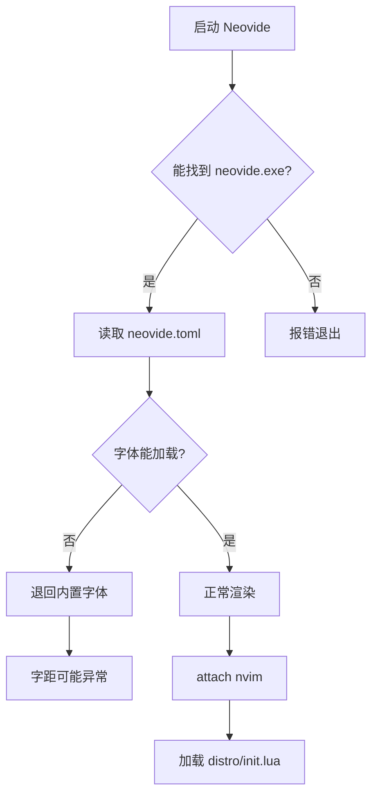
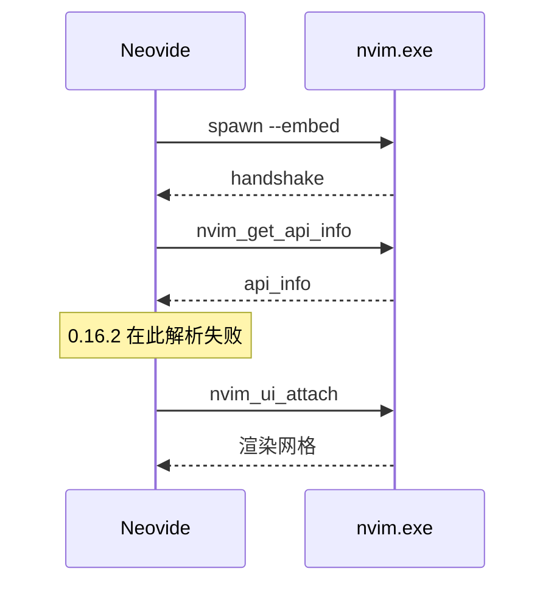
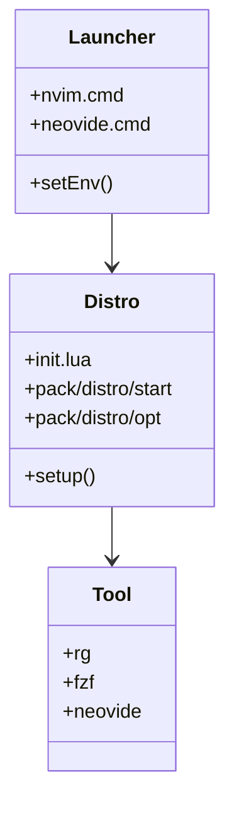
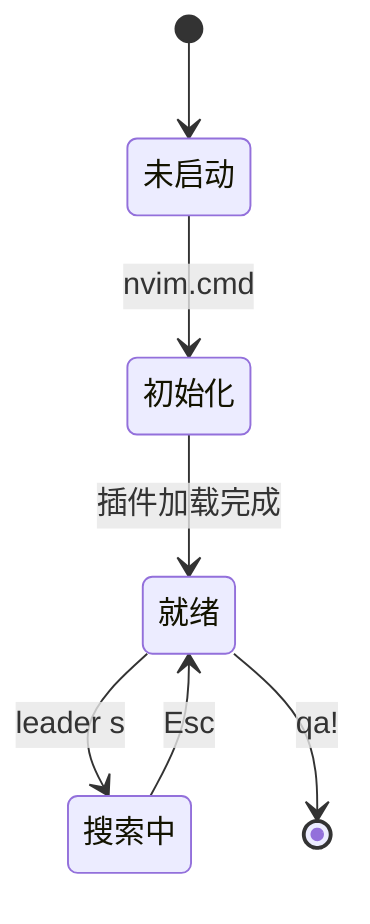
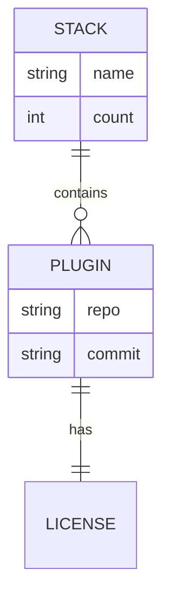
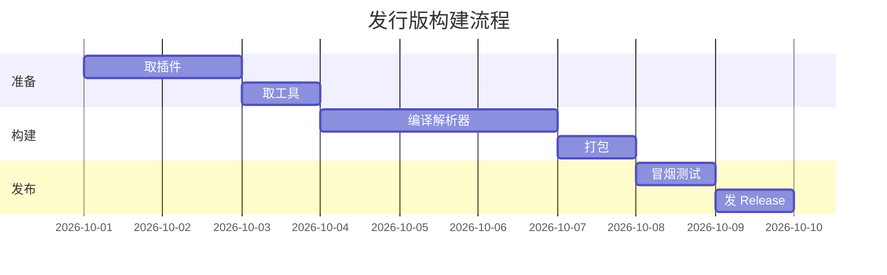
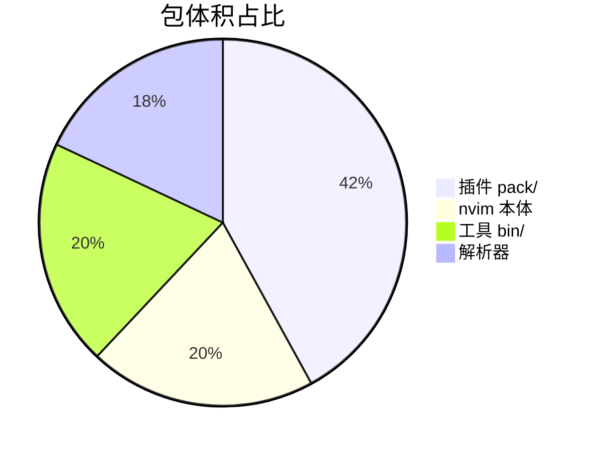
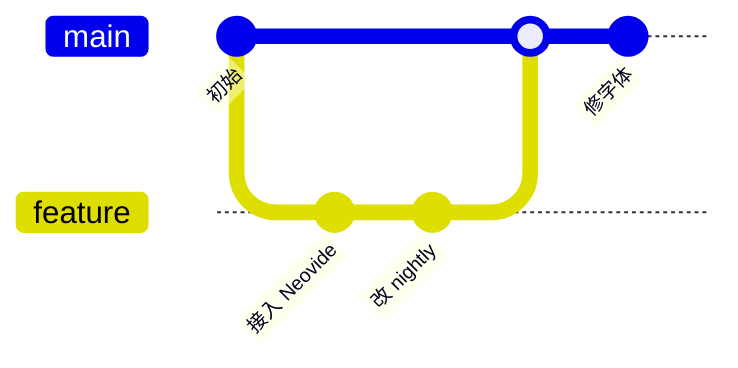
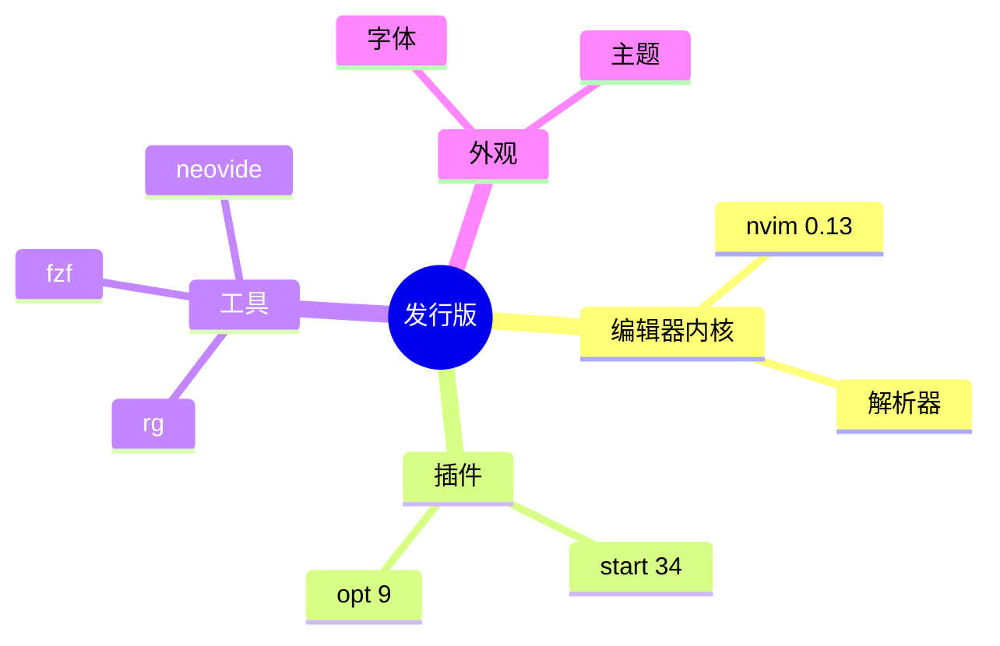
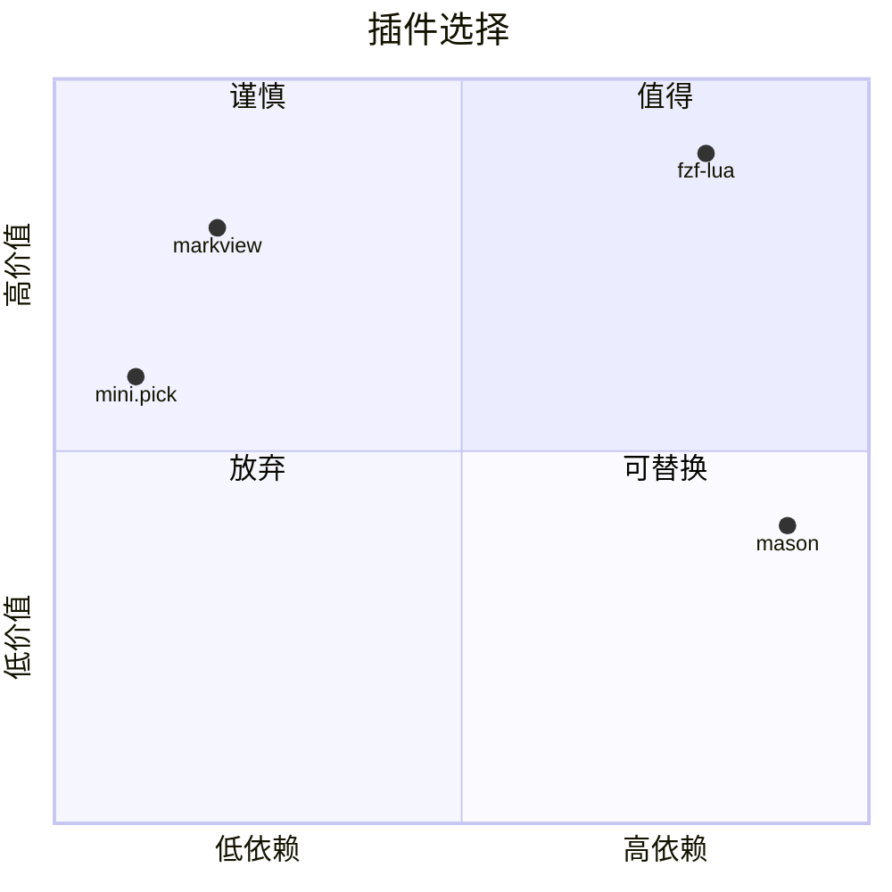

# Markdown 渲染测试 / Mermaid 语法测试

> 用途：① 用 Neovide + markview 观察 Markdown 渲染效果；② 贴到浏览器/在线 mermaid 编辑器里看图效果。
>
> 说明：markview **不渲染 Mermaid**，下面的图在编辑器中会显示为带高亮的代码块，属正常行为。

---

## 1. 标题层级

# 一级标题 H1
## 二级标题 H2
### 三级标题 H3
#### 四级标题 H4
##### 五级标题 H5
###### 六级标题 H6

## 2. 行内样式

普通文本、**粗体**、*斜体*、***粗斜体***、~~删除线~~、`行内代码`、[超链接](https://neovide.dev/)。

中文与 English 混排：这是中文，this is English，数字 1234567890，符号 `<>[]{}()`。

中日韩宽度测试（看字间是否出现空隙）：
- 中文：简体中文字符测试，一二三四五六七八九十
- 全角标点：，。、；：！？（）《》
- 半角与全角混排：abc，def。ghi；jkl
- 歧义宽度字符：± × ÷ ← → ↑ ↓ ★ ☆ ○ ● ◆ ◇

## 3. 列表

无序列表：
- 第一项
- 第二项
  - 嵌套项 A
  - 嵌套项 B
    - 更深一层
- 第三项

有序列表：
1. 第一步
2. 第二步
   1. 子步骤
   2. 子步骤
3. 第三步

任务列表：
- [x] 已完成的任务
- [ ] 未完成的任务
- [ ] 另一个未完成

## 4. 引用与提示

> 普通引用：这是一段引用文字。
>
> 第二段引用。

> [!NOTE]
> 提示类 callout。

> [!WARNING]
> 警告类 callout。

> [!TIP]
> 技巧类 callout。

## 5. 表格

| 左对齐 | 居中 | 右对齐 | 中文列 |
| :--- | :---: | ---: | --- |
| a | b | c | 中文 |
| 较长的单元格内容 | 中 | 1234 | 测试对齐 |
| `代码` | **粗体** | *斜体* | ✓ |

## 6. 代码块

Lua：
```lua
local distro = require('distro')
local ok = pcall(distro.setup)
if not ok then
  vim.notify('加载失败', vim.log.levels.ERROR)
end
```

Shell：
```bash
pwsh tools/vendor.ps1 -DryRun
python tools/check-stack.py
```

带行号的 JSON：
```json
{
  "platform": "win64",
  "tools": 7,
  "neovide": "nightly"
}
```

## 7. Mermaid 图表

### 7.1 流程图



### 7.2 时序图



### 7.3 类图



### 7.4 状态图



### 7.5 实体关系图



### 7.6 甘特图



### 7.7 饼图



### 7.8 Git 图



### 7.9 思维导图



### 7.10 时间线

```mermaid
timeline
    title 这次排查的时间线
    19:03 : 推送 Neovide
    19:35 : CI 出包
    20:00 : 发现 API 不兼容
    20:28 : 改随包 nightly
    20:45 : 报字体字距问题
```

### 7.11 象限图



---

## 8. 分隔线

上面一条

---

下面一条

## 9. 链接与图片

- [Neovide 官网](https://neovide.dev/)
- [markview.nvim](https://github.com/OXY2DEV/markview.nvim)
- 裸链接：https://github.com/bitbegin/packednvim

图片（指向不存在的路径，测占位显示）：


## 10. 脚注

这里有一个脚注引用[^1]，还有另一个[^2]。

[^1]: 第一个脚注的内容。
[^2]: 第二个脚注的内容。

---

## 测试要点

在 Neovide 里重点看这几处：

1. **标题**是否隐去 `#` 且字号/颜色有层次
2. **表格**竖线是否对齐，中文列是否撑开
3. **任务列表** `[x]` / `[ ]` 是否变成勾选框图标
4. **引用块**左侧是否有竖线，callout 是否带标题
5. **行内代码**是否有背景色
6. **中文字间**是否出现空隙（当前字体问题）
7. **Mermaid 块**应显示为高亮代码块，而不是图
8. 光标移进某段时，**该段应退回源码**（hybrid 模式），移开又变渲染

按 `<leader>um` 可整体关掉渲染对比效果。
